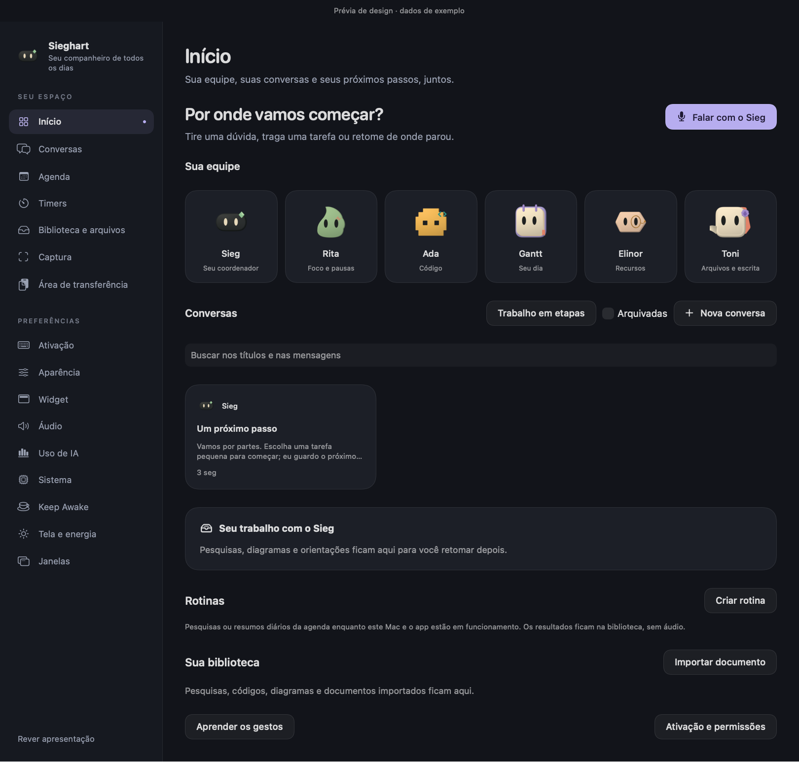
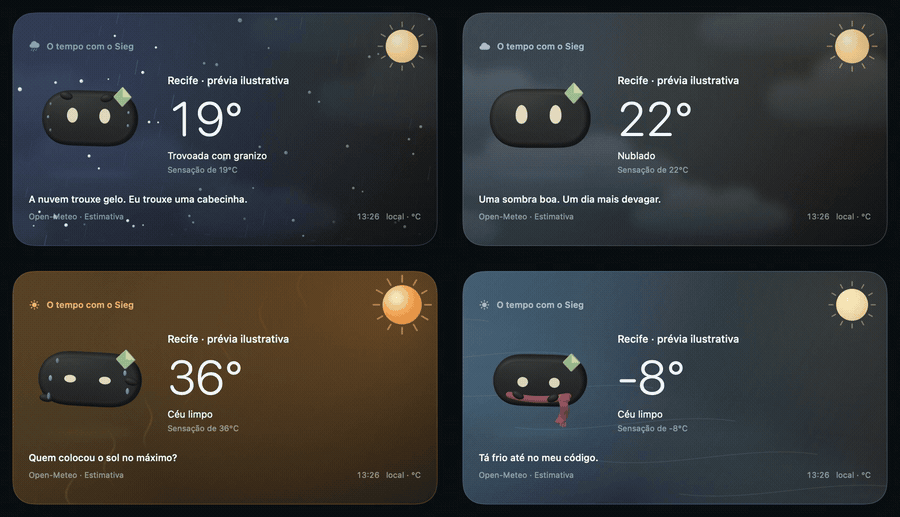
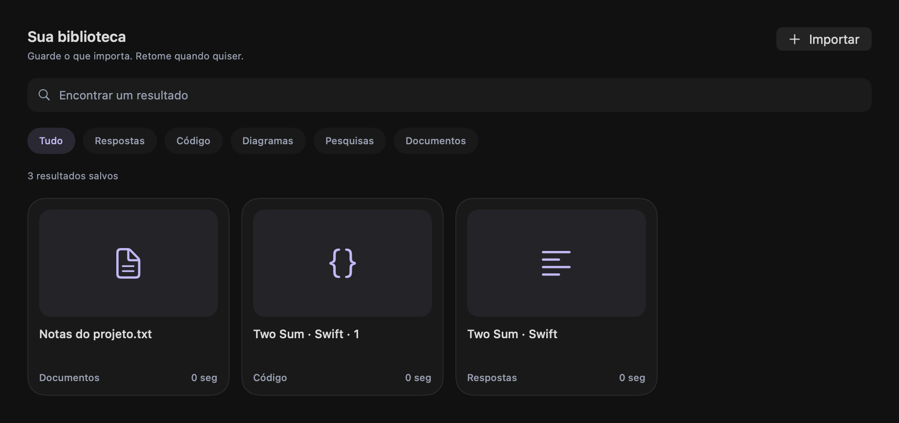

# HeyChomp

### Um próximo passo por vez, com o Chomp por perto.

HeyChomp é um app nativo para macOS que reúne conversas, foco e ferramentas do Mac. O **Chomp** acompanha o trabalho pelo widget próximo ao notch e coordena uma equipe de especialistas, mantendo conversas e resultados acessíveis na Home.

*Recorte silencioso da apresentação do runtime integrado, com os personagens atuais. [Ver o clipe completo](Sieghart/Design/Validation/team-runtime/hello-final.mp4).*

## Um companheiro, uma equipe

Chomp é o companheiro principal fixo. Os especialistas têm identidade e responsabilidade próprias; não são uma lista de avatares para substituí-lo.

| Chomp | Rita | Ada | Gantt | Elinor | Toni |
| --- | --- | --- | --- | --- | --- |
|  |  |  |  |  |  |
| Coordenação e ferramentas do Mac | Foco e pausas | Código e matemática | Agenda e rotina | Recursos | Arquivos e escrita |

A presença de um especialista não significa que todas as suas integrações estejam concluídas. Os limites atuais estão em [KNOWN_ISSUES.md](KNOWN_ISSUES.md).

## Conversas e trabalho no mesmo lugar

*Prévia das views de produção de 22/10/2026, com dados de exemplo. Não é uma comprovação de funcionamento de cada integração.*

| Área | Experiência implementada e limites |
| --- | --- |
| Conversas | Chomp como entrada, encaminhamento por especialidade, histórico, busca e conversas fixadas/arquivadas. |
| Voz | Segurar o atalho para falar e soltar para interpretar. Texto responde no chat; microfone recebe resultado visual e áudio no widget. Validação física do fluxo ainda pendente. |
| Contexto da tela | Captura solicitada, seleção, Accessibility e OCR. Permissões e qualidade em telas reais ainda precisam de aceite. |
| Desenhos e explicações | Formas e canvas de conteúdo gerado. Qualidade factual, composição de diagramas e pedidos compostos continuam em validação. |
| Foco e rotina | Timer, Pomodoro, cronômetro, agenda e retomada de resultados. |
| Ferramentas do Mac | Keep Awake com duração e opção de manter a tela ligada, áudio, captura, área de transferência e controles compatíveis com o dispositivo. |
| Biblioteca | Salve respostas e código, filtre resultados, volte à mensagem original e exporte arquivos. Arraste de resposta em Markdown validado no Finder. |

## O tempo com o Chomp

*Prévia animada com valores ilustrativos, exportada das cenas de produção. O app consulta o Open-Meteo para obter os dados; esta animação é uma demonstração visual.*

O personagem reage a nove estados climáticos, com variações de dia e noite. Chuva, neve, nuvens, granizo e efeitos térmicos ocupam o painel; acessórios e expressões acompanham o corpo do Chomp. Há adaptações para Reduzir Movimento. O recolhimento automático e as consultas de cidades arbitrárias ainda fazem parte da [validação em uso real](KNOWN_ISSUES.md).

[Prancha dos estados](Sieghart/Design/Workflow/evidence/sieg-weather-finish-2026-10-22/weather-finish-board.png) · [Clipe original](Sieghart/Design/Workflow/evidence/sieg-weather-finish-2026-10-22/weather-finish-motion.mp4) · [Origem das mídias do README](Sieghart/Design/Readme/README.md)

## Estado do produto

**Em desenvolvimento.** HeyChomp é o aplicativo. Chomp é o companheiro que antes se chamava Sieg. A base inspirada no HeyClicky já passou nos testes reais de Keep Awake, clima, OCR de imagem importada e retorno a um resultado salvo. Ainda faltam o alvo correto da leitura de tela, a seleção física de um recorte, a geração e revisão de diagramas com o modelo real e a rodada de voz com atalho, interrupção e AirPods. [Bugs e critérios de aceite](KNOWN_ISSUES.md).

O build **123** está instalado e foi testado por texto com o AFM 3 Core Advanced. O build **120** passou Complete (**491 funções / 1383 invocações**) e Fast (**422 / 1282**). [Checkpoint dos testes e limites](CURRENT_WORK.md).

A preparação para o Swift Student Challenge é uma etapa separada, adiada pelo autor enquanto o produto evolui. Este repositório contém o app macOS em Xcode.

## Abrir e desenvolver

Abra [Sieghart/HeyChomp.xcodeproj](Sieghart/HeyChomp.xcodeproj). O projeto usa Swift 6, SwiftUI, AppKit e SceneKit. O deployment target é macOS 14.6; o motor local AFM 3 exige macOS 27, hardware elegível e Apple Intelligence pronto. Recursos também dependem das permissões e APIs disponíveis no Mac.

[Compilação, instalação e testes](Sieghart/README.md) · [Arquitetura](Sieghart/ARCHITECTURE.md) · [Testes e evidências](Sieghart/Tests/README.md)

Para uma cópia instalada, use `/Applications/HeyChomp.app` e o script de lançamento do projeto. Não execute diretamente o binário interno do bundle. A atualização deve preservar uma sessão ativa de Keep Awake.

## Retomar o desenvolvimento

| Documento | Para quê |
| --- | --- |
| [HANDOFF.md](HANDOFF.md) | Ponto de entrada, decisões do produto, mapa de código e retomada no Claude. |
| [CURRENT_WORK.md](CURRENT_WORK.md) | Checkpoint vivo: o que mudou, evidências e próxima ação. |
| [KNOWN_ISSUES.md](KNOWN_ISSUES.md) | Bugs, limitações e critérios de aceite ainda pendentes. |
| [RESEARCH_INDEX.md](RESEARCH_INDEX.md) | Pesquisas/REA dos aplicativos de referência e alcance de cada estudo. |
| [CLAUDE.md](CLAUDE.md) e [AGENTS.md](AGENTS.md) | Instruções de trabalho e preservação das mudanças. |

Os relatórios de sprint e conceitos antigos são históricos. Eles continuam em [Design](Sieghart/Design/) e no histórico Git; não representam automaticamente o produto atual. Os GIFs e retratos acima usam a equipe integrada, substituindo as demonstrações dos avatares removidos.

## Licença

[MIT](LICENSE). Atribuições e limites dos recursos de terceiros estão em [THIRD_PARTY_NOTICES.md](Sieghart/THIRD_PARTY_NOTICES.md).

Edição natural de diagramas no build 112: mover, renomear e destacar blocos pelos títulos atuais, preservando relações e recusando ambiguidades. [Mudanças, testes e limites](Sieghart/Design/Workflow/sieg-canvas-revision-2026-10-29.md). Sem testes de áudio físico ou aceite de leitura/modelo real nesta etapa.

Build 114: recuperação de leitura com conversa/recorte originais, rascunho e anexos preservados; expiração encerra apenas a tarefa correspondente. Inclui o contexto e descarte de resultados atrasados do lote 113. [Entrega de 03/11 e limitações](Sieghart/Design/Workflow/sieg-screen-recovery-2026-11-03.md).

Build 115: avisos localizados, detalhes técnicos expansíveis, recuperação dentro da rolagem do widget e anexos legíveis. Indicador do personagem reflete indisponibilidade do modelo. [Acabamento, evidências e limites](Sieghart/Design/Workflow/sieg-interface-polish-2026-11-03.md).

## Apple Foundation Models e nuvem

O modo local depende do Apple Intelligence pronto no Mac. A integração com o Private Cloud Compute está no código e o build de desenvolvimento usa apenas os entitlements locais. Faltam o identificador definitivo de distribuição, a concessão da Apple, o perfil correspondente e uma resposta real em um build de TestFlight ou ad hoc. [Estado e passos de ativação](Sieghart/Design/Workflow/apple-private-cloud-setup-2026-11-03.md).

Build 116: espera por permissões de voz com prazo/cancelamento e recuperação nos Ajustes. Seleção callbacks/voice-integration: **125 funções / 176 invocações** aprovada. Atualização preservou o Keep Awake ativo; início e encerramento da escuta observados no app, ainda sem aceite de uma conversa completa. [Evidência e limites](Sieghart/Design/Workflow/sieg-voice-access-2026-11-04.md).

## Respostas que viram arquivos

O chat permite salvar uma resposta ou um bloco de código na biblioteca, com retorno à mensagem original. Busca, filtros e prévias ajudam a retomar; exportação conserva o PDF original e oferece texto extraído em `.txt` quando ele está ausente. Contratos dirigidos: **257 funções / 764 invocações** aprovadas; build 118 instalado na cópia canônica. [Mudanças e limites](Sieghart/Design/Workflow/sieg-artifact-flow-2026-11-04.md).

Testes de som e microfone estão suspensos a pedido do usuário desde 04/11.

O teste na janela real abriu a resposta correta depois de trocar de conversa e não reproduziu a borda amarela do catálogo. O 118 anuncia o arquivo primeiro como URL nativa e passou **145 funções / 607 invocações**. No gesto real, o Finder recebeu um `.md` com bytes idênticos à resposta salva. [Fechamento da base HeyClicky e plano do Chomp](Sieghart/Design/Workflow/chomp-heyclicky-closeout-2026-11-05.md).

O **Chomp 119** passou **491 funções / 1383 invocações** no Complete e **422 / 1282** no Fast. Keep Awake, clima e OCR da imagem sintética foram confirmados no app. Seleção da janela certa, gesto de recorte e diagramas reais continuam com aceite separado. [Renomeação e resultados](Sieghart/Design/Workflow/chomp-rename-acceptance-2026-11-05.md).
