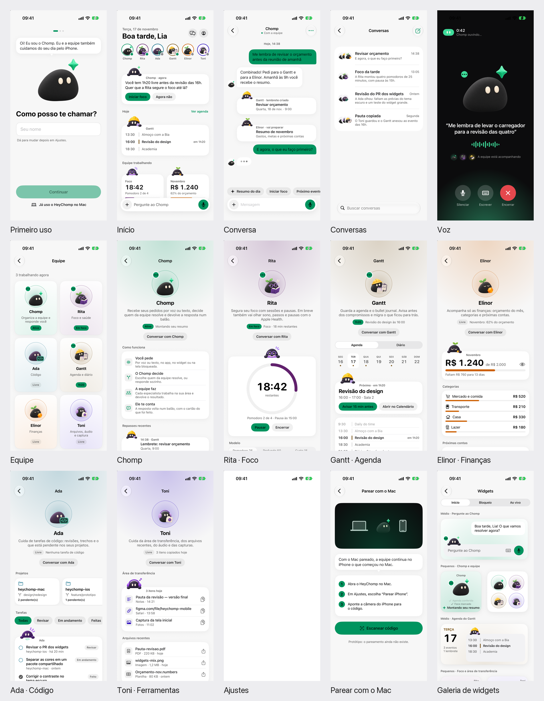
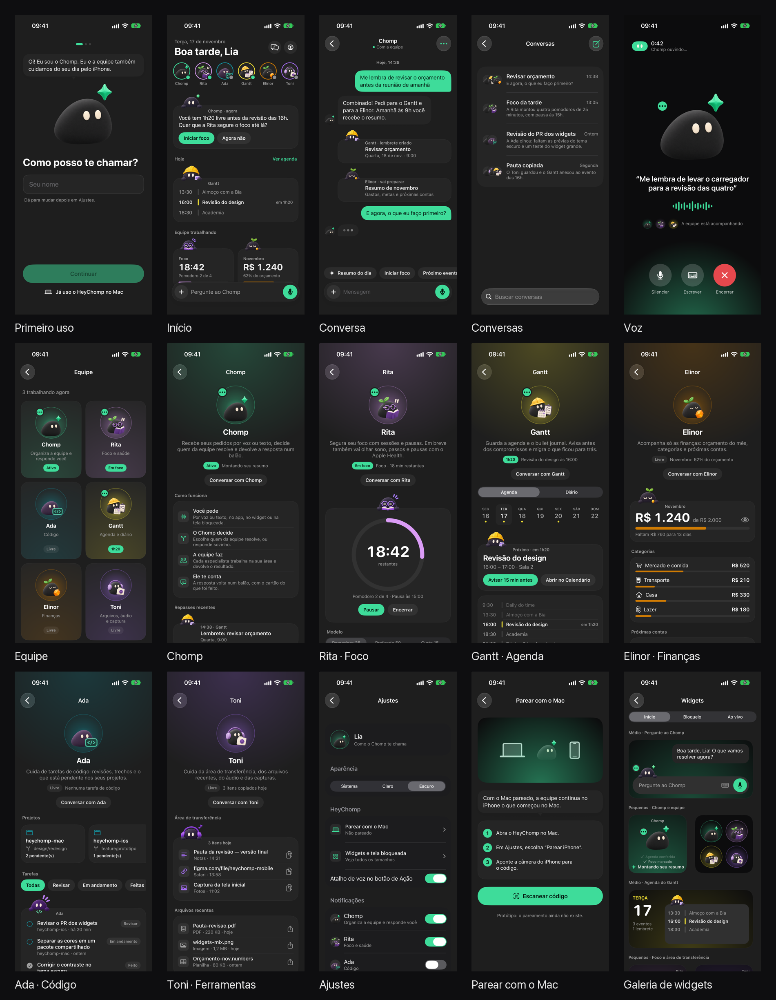

# HeyChomp para iPhone: protótipo de telas

Protótipo navegável de **todas as telas** do app iOS, em SwiftUI e MVVM. Não tem lógica de negócio, rede, persistência nem permissões reais. Todos os dados são fictícios e ficam em um único arquivo (`Services/MockDataSource.swift`).

Ele segue a direção visual aprovada em [`Design/Concepts/mobile-2026-11-17/`](../Design/Concepts/mobile-2026-11-17/README.md): personagens espiando por cima dos cartões, balões do Chomp, pílulas de ação e a mistura v1 + v2 nos widgets.

| Tema claro | Tema escuro |
|---|---|
|  |  |

## O que é e o que não é

- **É:** todas as telas, a navegação entre elas, os estados de interface (passos do primeiro uso, abas, filtros, interruptores, foco iniciado ou pausado, valores ocultos) e a galeria de widgets em tamanho real.
- **Não é:** nada é enviado, salvo ou lido do aparelho.
  - O microfone **não** é aberto e nenhum áudio é tocado.
  - O pareamento com o Mac, o Apple Health e o Apple Pay não existem.
  - Enviar uma mensagem só mostra o balão e um aviso de que nenhuma resposta é gerada. O projeto proíbe respostas prontas fingindo inferência.
- Exceção: a escolha do ícone do app é real, porque o usuário pediu para personalizar o avatar.
- Os widgets ainda **não** são uma extensão WidgetKit. São views comuns, mostradas em **Ajustes → Widgets e tela bloqueada**.

## Abrir e rodar

Requer Xcode 26 ou mais recente (o projeto usa pastas sincronizadas, `objectVersion 77`). O alvo mínimo é iOS 17 e a linguagem é Swift 6, com concorrência estrita.

1. Abra `Sieghart/iOS/HeyChompMobile.xcodeproj`.
2. Escolha o esquema **HeyChompMobile** e um simulador de iPhone.
3. Rode (⌘R). O app começa pelo primeiro uso.

Pela linha de comando:

```bash
cd Sieghart/iOS && xcodebuild -project HeyChompMobile.xcodeproj -scheme HeyChompMobile -destination 'generic/platform=iOS Simulator' -derivedDataPath /tmp/heychomp-ios-dd build
```

### Abrir direto numa tela

Para revisar sem passar pelo primeiro uso, use os argumentos de lançamento. No Xcode, eles já estão no esquema, desligados (Edit Scheme → Run → Arguments).

```bash
xcrun simctl launch booted com.sieghart.heychomp.mobile.prototype -startScreen rita -appearance dark
```

| Argumento | Valores |
|---|---|
| `-startScreen` | `onboarding` (padrão), `home`, `chat`, `conversations`, `voice`, `team`, `chomp`, `rita`, `ada`, `gantt`, `elinor`, `toni`, `settings`, `widgets`, `pair`, `icon` |
| `-appearance` | `system` (padrão), `light`, `dark` |

### Regerar as pranchas de telas

```bash
Sieghart/iOS/Tools/capture-screens.sh "iPhone 17"
```

O script compila, instala no simulador, captura as 15 telas nos dois temas e monta `Docs/telas-claro.png` e `Docs/telas-escuro.png`. Precisa de Python 3 com Pillow.

## Telas

| Tela | Arquivos | O que mostra |
|---|---|---|
| Primeiro uso | `Features/Onboarding` | 1. O Chomp se apresenta num balão e pergunta o nome. 2. A equipe em cartões com o personagem espiando e as pílulas "em breve". 3. Permissões, cada uma com o agente dono (interruptores só visuais). Também tem a opção "Já uso o HeyChomp no Mac". |
| Início | `Features/Home` | Saudação, fileira da equipe com status, sugestão do Chomp com pílulas, "Hoje" (agenda do Gantt), resumos de Rita, Elinor, Ada e Toni, e a barra fixa "Pergunte ao Chomp" (+, texto e microfone). |
| Conversa | `Features/Chat` | Balões da pessoa e do Chomp, cartões de repasse com o especialista espiando, "digitando", sugestões em pílulas e campo com microfone. |
| Conversas | `Features/Conversations` | Histórico com busca e os avatares de quem participou. |
| Voz | `Features/Voice` | Tela cheia escura: Chomp com brilho, transcrição, onda sonora, equipe acompanhando e os controles silenciar, escrever e encerrar. |
| Equipe | `Features/Team` | Os seis em grade, de rosto, com status. |
| Chomp | `Features/Agents/Chomp` | Como um pedido anda pela equipe, repasses recentes e especialistas. |
| Rita | `Features/Agents/Rita` | Anel de foco, modelos de sessão, silenciar notificações, sessões de hoje e Saúde (em breve). |
| Gantt | `Features/Agents/Gantt` | Abas Agenda (faixa da semana, próximo evento e linha do tempo) e Diário (bullet journal), além de E-mail (em breve). |
| Elinor | `Features/Agents/Elinor` | Orçamento do mês, categorias, próximas contas, lançamentos, ocultar valores e Apple Pay (em breve). |
| Ada | `Features/Agents/Ada` | Projetos, tarefas com filtro e trecho de código guardado. |
| Toni | `Features/Agents/Toni` | Área de transferência, arquivos recentes, saída de áudio com volume e atalhos de captura. Também tem a folha de anexos do "+". |
| Ajustes | `Features/Settings` | Nome, tema (Sistema, Claro ou Escuro, aplicado de verdade na interface), ícone do app, Mac, widgets, atalho de voz, notificações por agente e "Rever o primeiro uso". |
| Ícone do app | `Features/Settings/AppIconPicker*` | Escolha do avatar do ícone: o Chomp é o padrão e qualquer agente pode aparecer. **Troca o ícone de verdade** (`setAlternateIconName`); o iOS mostra o próprio aviso de confirmação. |
| Parear com o Mac | `Features/Settings/PairMacView.swift` | Explicação visual em três passos. |
| Widgets | `Features/WidgetGallery` | Início (médio, pequenos e grande), Bloqueio (acessórios monocromáticos) e Ao vivo (Dynamic Island de voz e duas Live Activities). |

## Organização

```
Sieghart/iOS/
├── HeyChompMobile.xcodeproj    projeto separado do Mac, com pastas sincronizadas
├── HeyChompMobile/
│   ├── App/                    entrada, estado global, navegação e opções de lançamento
│   ├── DesignSystem/           tokens (Theme) e componentes reutilizáveis
│   ├── Models/                 structs e enums puros (Sendable), sem SwiftUI
│   ├── Services/               protocolo DataSource + MockDataSource (dados fictícios)
│   ├── Features/<Tela>/        <Tela>View.swift + <Tela>ViewModel.swift
│   └── Resources/              ícone do app e cor de destaque
├── Docs/                       pranchas com as telas
├── Tools/                      captura das telas
├── README.md                   este arquivo
└── ARCHITECTURE.md             MVVM, navegação, design system e próximos passos
```

### Ícone do app

O ícone "Espiando" tem as variantes clara, escura e tingida. O **ícone principal (Chomp) é o mesmo do Mac** e fica no catálogo compartilhado (`Sieghart/Shared/Resources/ProviderAssets.xcassets/AppIcon.appiconset`). Os alternativos (`AppIcon-Rita`, `-Ada`, `-Gantt`, `-Elinor`, `-Toni`) e as miniaturas (`IconPreview-*`) ficam em `Resources/Assets.xcassets`. Tudo é gerado por:

```bash
cd Sieghart && python3 Tools/app-icon/generate_app_icons.py
```

Os personagens (`Peek-*` e `Companion-*`) **não foram copiados**. O projeto referencia o asset catalog do Mac (`../Sieghart/Shared/Resources/ProviderAssets.xcassets`), que aparece no Xcode no grupo "Compartilhado com o Mac".

Detalhes de arquitetura e de como adicionar uma tela estão em [ARCHITECTURE.md](ARCHITECTURE.md).
